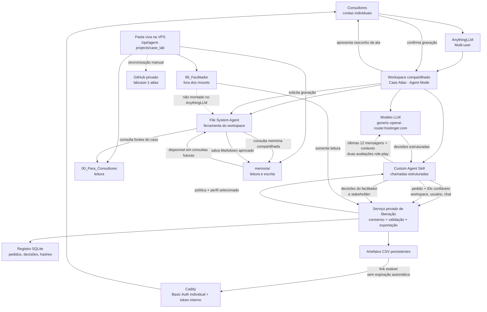

# Case Lab — Indústria Atlas

O Case Lab é uma simulação compartilhada de consultoria. A pasta do projeto na VPS é a base viva; o AnythingLLM oferece a interface comum para a equipe; o GitHub continua sendo usado por você para versionar mudanças quando fizer a sincronização manual.

## Experiência desejada para o consultor

1. Entra no AnythingLLM com sua própria conta e abre o workspace **Case Atlas**.
2. Começa a conversa em linguagem natural: “Quero entrevistar Ana Paiva sobre os atrasos de produção.”
3. O assistente já conhece o caso e assume a persona; não precisa pedir para ler arquivos nem usar `@agente` a cada mensagem.
4. Ao terminar, o assistente mostra uma ata padronizada e pergunta se deve registrá-la. Só após “sim” cria o Markdown na memória compartilhada da VPS.
5. Em outra thread, a equipe pode consultar as entrevistas e decisões registradas.

## Fluxo da arquitetura

Os consultores entram com contas individuais no AnythingLLM e usam o workspace compartilhado. O Agent Mode conduz a conversa com o modelo configurado e pode acionar o File System Agent para ler o briefing, as personas e a memória. A ata é apresentada ao consultor; a gravação na pasta compartilhada só deve ocorrer depois de uma confirmação explícita. Outros usuários podem consultar os arquivos salvos em conversas futuras.

Para liberação de arquivos de dados, o custom Agent Skill chama um serviço privado fora do AnythingLLM. Esse serviço é o único componente autorizado a ler `99_Facilitador/`, montada nele somente em leitura. Ele fornece ao modelo apenas a política geral e o perfil da persona selecionada; o modelo faz duas avaliações separadas como facilitador e stakeholder, usando também as últimas 12 mensagens do chat. O CSV original e suas linhas não são enviados ao modelo. O serviço exige que ambas as avaliações permitam o escopo, valida colunas e período no catálogo fechado, exporta uma cópia CSV e registra a conversa de origem e os hashes. A cópia fica disponível por link estável, sem expiração automática, atrás de autenticação individual do Caddy. Detalhes em [Fluxo de liberação de dados](docs/fluxo-liberacao-de-dados.md).

O AnythingLLM recebe dois mounts específicos: `00_Para_Consultores/` em somente leitura e `memoria/` em leitura e escrita. `99_Facilitador/` fica fora dos mounts. O GitHub privado é usado para versionamento manual; não participa da execução do workspace nem sincroniza arquivos automaticamente.

## Validação da arquitetura

Verificações estruturais executadas na VPS:

- O contêiner AnythingLLM monta `00_Para_Consultores/` como somente leitura e `memoria/` como leitura e escrita.
- O contêiner consegue ler os arquivos de consultoria, não consegue escrever nessa pasta e consegue ler e escrever na memória.
- `99_Facilitador/` não aparece entre os mounts do contêiner.
- `99_Facilitador/verificar_data_room.py` passou: 31.554 linhas em 15 CSVs, com vínculos, capacidade, produção, expedição, backlog e fechamento financeiro conferidos.

Essas verificações validam os dados e o isolamento dos mounts, mas ainda não comprovam o fluxo completo do agente. Antes de convidar a equipe, faça um piloto na interface com duas contas: confirme que o Agent Mode aciona o File System Agent sem `@agent`, consulta os arquivos corretos, pede confirmação antes de gravar, salva a ata em `memoria/` e permite que a segunda conta a consulte. Confirme também que o agente não consegue acessar `99_Facilitador/`.

## GitHub do projeto

Nenhuma integração ou configuração do GitHub é necessária para o AnythingLLM funcionar. O workspace usa a pasta viva da VPS; o repositório privado `armel-felipe/labcase-1-atlas` serve para versionamento manual do código e da documentação. O fluxo de liberação e seu diagrama estão documentados neste README e em [Fluxo de liberação de dados](docs/fluxo-liberacao-de-dados.md).

## Pastas que o AnythingLLM pode acessar

Monte **somente** estas pastas na configuração Docker do AnythingLLM:

| Pasta na VPS | Acesso | Conteúdo |
|---|---|---|
| `case_lab/00_Para_Consultores` | Leitura | Briefing, mapa de personas, entrevistas iniciais e catálogo público |
| `case_lab/memoria` | Leitura e escrita | Atas, índice de entrevistas e decisões confirmadas |

Não monte `99_Facilitador/`, nem a pasta-pai `case_lab/`. Isso mantém os materiais reservados fora do alcance das ferramentas de arquivos do workspace. O AnythingLLM exige mounts explícitos para o File System Agent no Docker e permite configurar permissões de leitura/escrita ([File System Agent](https://docs.anythingllm.com/agent/usage/file-system-agent)).

## Configuração resumida

O Agent Mode mantém o fluxo de entrevistas. Para pedidos de dados, veja as etapas, os limites de acesso e o estado operacional em [Fluxo de liberação de dados](docs/fluxo-liberacao-de-dados.md).

## Liberação de dados do facilitador

O serviço de liberação mantém `99_Facilitador/` fora dos mounts do AnythingLLM, registra decisões em SQLite e produz cópias CSV imutáveis. A implementação está ativa na VPS; este repositório documenta o fluxo, sem tokens ou credenciais da implantação. O código e os arquivos Compose usados na VPS permanecem no checkout `/opt/agent-projects/case_lab` e não fazem parte desta atualização documental. A rota ativa no Caddy exige autenticação Basic individual da equipe. Consulte [Fluxo de liberação de dados](docs/fluxo-liberacao-de-dados.md).

A integração está ativa na VPS: o serviço de liberação não publica porta no host, o custom Agent Skill está instalado no armazenamento persistente do AnythingLLM, e a rota de download do Caddy exige Basic Auth individual. O teste da fronteira retornou `401` sem credenciais e alcançou o serviço com as três contas válidas. Ainda não foi publicado nenhum CSV. Falta testar uma invocação real pelo chat para confirmar os metadados internos de usuário e conversa.

Para cada pedido novo, o skill envia as últimas 12 mensagens relevantes e o contexto de política/persona ao provider LLM configurado no workspace, em duas avaliações de role-play. No ambiente verificado, o provider é `generic-openai` com endpoint `router.hostinger.com`. O CSV original e suas linhas não são enviados ao modelo. A integração foi ativada após autorização para esse tratamento; faça um primeiro pedido vago pelo chat e confirme que ele pede esclarecimento antes de solicitar dados reais.

Após atualizar/recarregar a página do AnythingLLM, abra uma conversa nova no workspace Case Atlas; a skill aparecerá entre as ferramentas do agente. As credenciais Basic Auth são individuais e ficam armazenadas com acesso restrito na VPS. Ao adicionar um consultor à instância, provisionar também uma credencial de download individual no Caddy.

## Limites importantes

- O workspace usa uma configuração de modelo compartilhada; não é um projeto ChatGPT em que cada consultor escolhe seu próprio modelo.
- Cada pessoa usa sua própria conta. A memória da equipe são as atas Markdown na VPS; não dependa das threads individuais para compartilhar o histórico. Administradores podem ter acesso aos registros de chat conforme suas permissões.
- Ativar Multi-user é uma mudança importante da instância: a documentação informa que não há retorno ao modo single-user. Faça backup e confira os impactos antes de habilitar.
- Não use o antigo scaffold em `mcp_server/` / `compose.mcp.yaml` para esta configuração. Ele foi criado para conectar o ChatGPT por OAuth/MCP e adicionaria complexidade sem resolver a usabilidade do AnythingLLM.
- Antes de convidar toda a equipe, faça um piloto com duas contas e confirme: cada uma vê apenas os workspaces autorizados; o Agent Mode chama o File System Agent sem comando especial; a ata vai para a VPS e aparece na conversa de outro usuário.
- A regra de confirmação e o template orientam o modelo, mas o File System Agent não valida o conteúdo do Markdown como um sistema de banco de dados. Se o piloto mostrar falhas de gravação ou formato, a etapa seguinte é adicionar uma única ferramenta de gravação estruturada — sem trocar a interface do consultor.
- A sincronização para o GitHub continua manual e sob responsabilidade do mantenedor.

## Estado da implantação

Em 13/11/2026, foram confirmados na VPS os mounts dos materiais de consultoria (somente leitura) e da memória (leitura e escrita). `99_Facilitador/` ficou fora dos mounts do AnythingLLM. O serviço de liberação de dados, o skill e a rota autenticada do Caddy estão ativos.

Pendente: executar um piloto real pelo chat autenticado do AnythingLLM para confirmar a invocação do skill, a captura dos identificadores internos do usuário e da conversa e o comportamento do provider. Nenhum CSV foi liberado até o momento. A sincronização para o GitHub continua manual.
